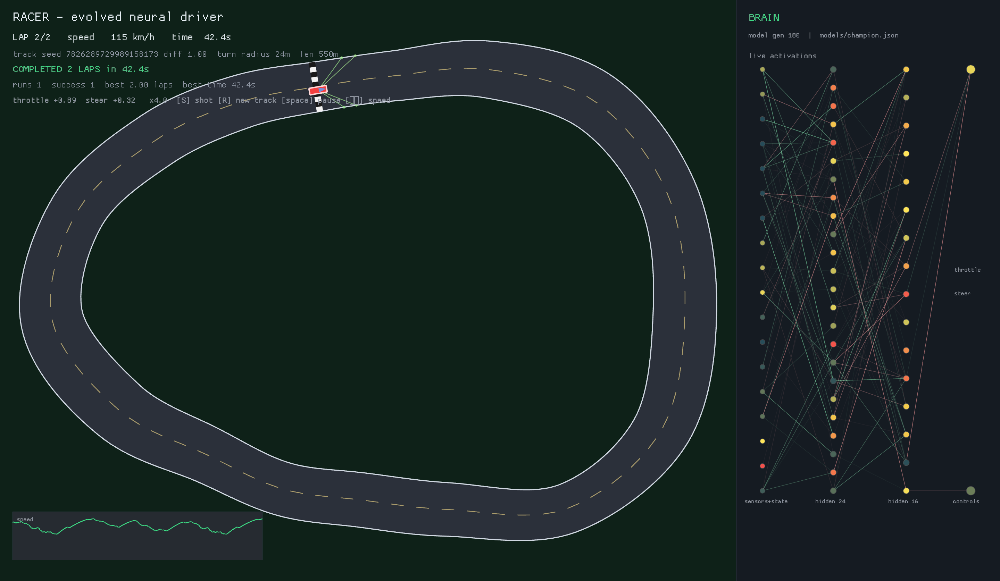
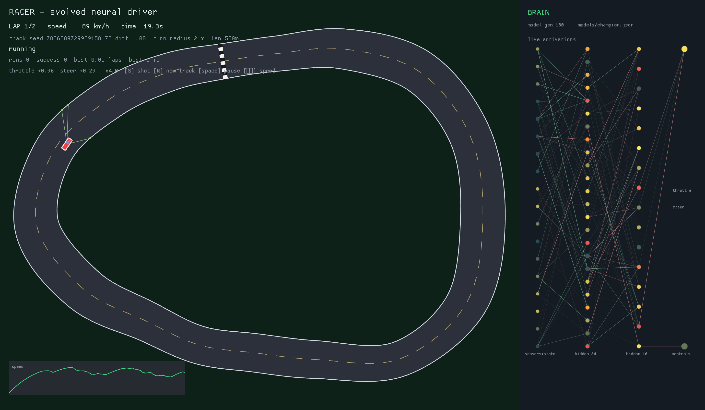
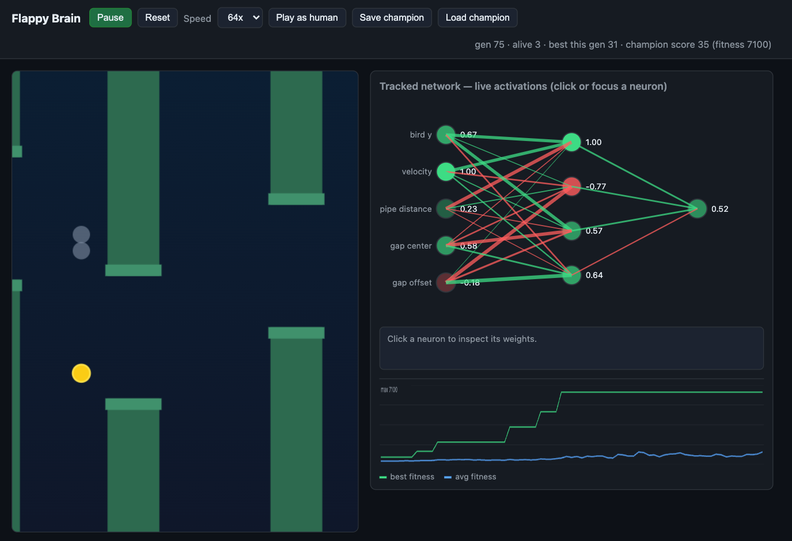

# neural-network

Two games where the player is a neural network that taught itself — nobody
programmed the driving or the flapping. You can watch both live: the racer
racing, the flappy birds learning as you look.



## Racer — a car that taught itself to drive

Nobody wrote the driving. A small neural network starts out driving into the
grass and evolves, generation after generation, until it laps tracks it has
never seen before. The shipped network drove **920 out of 920 unseen races** —
two clean laps each, zero crashes.



To watch it live you need [Rust](https://rustup.rs):

```bash
cd racer
cargo run --release -- watch --model models/champion.json
```

The car races on the left; on the right you see its actual brain — every
neuron, live. Press `R` to throw it a brand-new random track and watch it
figure that one out too. The full training story, results table, and
evaluation data are in [`racer/README.md`](racer/README.md).

## Flappy Brain — birds that learn to flap in about a minute

A Flappy Bird clone where a whole population of birds evolves while you
watch. They start out splatting into pipes at random; roughly a minute of
evolution at 64x speed later, bird after bird sails through gaps — and the
panel on the right shows the best bird's brain firing in real time.



To watch it live you need [Node.js](https://nodejs.org):

```bash
npm install
npm run dev
```

Open http://localhost:5173, press **Start evolution**, set the speed to 64x,
and give it about a minute.

## What am I looking at?

Both demos use neuroevolution: a population of random neural networks plays
the game, the best ones become the parents of the next generation, and the
loop repeats — evolution does the programming. The research notes behind the
approach are in [`docs/research/racing-ai.md`](docs/research/racing-ai.md).
