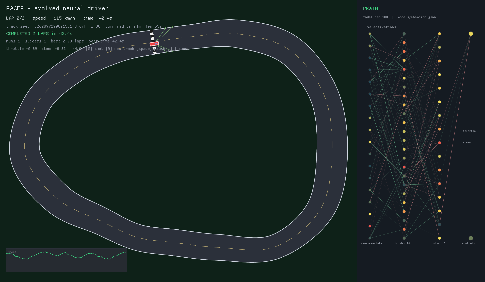

# Racer — a neuroevolved driver on random tracks

Top-down 2D racing game in Rust. Every circuit is procedurally generated, and a
small neural network drives the car using lidar-style range sensors. The network
is trained by a genetic algorithm; the shipped champion completes **two full
laps without crashing** on unseen random tracks.



## Quick start

```bash
cd racer
cargo run --release -- watch --model models/champion.json
```

The viewer shows the live race, the nine sensor rays, and every neuron and
significant weight of the driving network.

| key | action |
|---|---|
| `S` / `P` | save a screenshot to `screenshots/` |
| `R` | new random track |
| `Space` | pause |
| `↑` / `↓` | simulation speed (0.25x … 32x) |
| `Esc` | quit |

Unattended capture:

```bash
cargo run --release -- watch --model models/champion.json \
  --shots screenshots --shot-every 0.8 --auto-track 1 --speed 4 --exit-after 14
```

## Commands

```bash
# Train from scratch (the exact run that produced models/champion.json).
cargo run --release -- train --seed 9 --generations 250 --population 320 \
  --tracks-per-gen 20 --ramp 100 --validation-tracks 200 \
  --validation-candidates 8 --validation-every 10 \
  --validation-seed 550000 --validation-seed2 650000 --width-scale 0.85 \
  --target-success 2.0 --out models/champion.json

# Evaluate on 100 fresh tracks; exits nonzero unless every run is a clean 2 laps.
cargo run --release -- eval --model models/champion.json --tracks 100 --seed 1000000 \
  --min-success 1.0 --json docs/results/final_eval_1000000.json

# Hand-written pure-pursuit reference driver (physics/lap sanity check).
cargo run --release -- baseline --tracks 20 --seed 500000

# Tests, including an acceptance test that drives the shipped champion.
cargo test --release
```

Training writes `models/<name>.json` (champion), `models/<name>.history.csv`
(per-generation stats) and prints a validation line every few generations.
`--resume models/champion.json` continues an existing model at full difficulty.

## How it works

**Simulation** (`src/sim.rs`, `src/car.rs`, `src/track.rs`) — fixed 60 Hz
physics, 30 Hz policy. A kinematic bicycle model at the rear axle:

```
heading += speed / wheelbase * tan(steer) * dt
pos     += speed * dt * (cos heading, sin heading)
```

Steering has a slew limit, and the available lock shrinks with speed so the car
obeys a lateral-grip budget `v²·tan(δ)/L ≤ a_lat`. Fast cars therefore have to
brake for corners instead of turning on the spot. A run ends when any body
corner leaves the road, after two laps, or at the time limit.

**Sensors and inputs** — nine rays spanning 160°, normalized as
`1 − distance/range`, plus speed, signed lateral offset, heading error, yaw
rate, two signed curvature samples (22 m / 60 m), the worst curvature in two
lookahead windows (2–45 m, 45–90 m), and the deceleration required right now
to reach the tightest upcoming sample at the grip-limited speed. That is
18 inputs. The lookahead and braking-need cues are what make early braking
learnable rather than reactive.

**Tracks** (`src/track.rs`) — closed Catmull–Rom centerlines through 10–17
radial control points, arc-length resampled every 2 m. Candidate layouts are
rejection-sampled until curvature radius ≥ 9 m and distant parts of the road
cannot overlap; the road width breathes between roughly 15 m and 30 m depending
on difficulty. The start is placed on the straightest part.

**Brain** (`src/nn.rs`) — 18 → 24 → 16 → 2 tanh MLP (890 parameters). Outputs
are throttle and steering in `[-1, 1]`.

**Evolution** (`src/ga.rs`, `src/train.rs`) — population 320, elitism,
tournament selection, uniform crossover, Gaussian mutation with annealing, and
4 % fresh random immigrants each generation. Every genome is scored on 20
freshly generated tracks per generation, so selection cannot memorize a layout.
Training roads are generated at 85 % width, so the policy learns a safety
margin before it is evaluated at full width. A difficulty curriculum widens
from 0.30 to 1.0 over the first 100 generations.

**Fitness** — distance along the centerline is always positive; finishing adds
a flat bonus plus a speed bonus. Crashing halves the distance reward. Two
shaping terms teach margin and anticipation: using more than 70 % of the road
width costs a little, and carrying throttle while the preview says braking is
already required divides the score by `1 + 2·violation`. Both are multiplicative
or bounded, so a parked car never outranks forward progress.

**Champion selection** — every 10 generations the eight best genomes are
evaluated on 200 fixed, full-difficulty tracks drawn from two independent seed
bases. The best aggregate is saved atomically. `--target-success 2.0` disables
early stopping for the shipped run, so the full 250-generation schedule is used.
The final test uses seed bases never used for training or selection.

**Determinism** — a dependency-free SplitMix64 RNG drives track generation and
evolution. Physics and sensors are pure `f32` math. The same seed, policy and
engine reproduce the same run; `tests/champion.rs` and the replay unit test guard
this.

## Results

The shipped model (`models/champion.json`, generation 180) was selected on 200
fixed validation tracks at full difficulty. It was then run on **920 unseen
tracks**: nine independent 100-track seed bases plus a 20-track acceptance base,
with **920/920 clean two-lap runs** and no crashes:

| seed base | tracks | clean 2-lap runs | mean time |
|---|---|---|---|
| 700000 | 100 | 100 | 43.4 s |
| 800000 | 100 | 100 | 43.8 s |
| 900000 | 100 | 100 | 43.4 s |
| 1000000 | 100 | 100 | 43.6 s |
| 1200000 | 100 | 100 | 44.3 s |
| 1300000 | 100 | 100 | 43.8 s |
| 1400000 | 100 | 100 | 43.3 s |
| 1500000 | 100 | 100 | 43.7 s |
| 2000000 | 100 | 100 | 43.4 s |
| acceptance test, base 1600000 | 20 | 20 | 44.7 s |

Training itself reaches 200/200 validation in 250 generations (~11 minutes on
an M-series laptop, 320 genomes × 20 tracks per generation). The safe policy is
slower than an unconstrained one (a 99.5 %-success policy managed ~35.6 s), which
is the intended trade: the deliverable is completing both laps every time.

`docs/results/final_eval_*.json` contains every run's laps, time, speed and
lateral error; `docs/results/training_final.log` and
`models/champion.history.csv` contain the training trace.

## Layout

```
racer/
  src/math.rs      vector math, ray/segment intersection
  src/rng.rs       deterministic SplitMix64
  src/track.rs     procedural circuits + rejection sampling
  src/car.rs       kinematic bicycle with grip-limited steering
  src/sim.rs       episode, sensors, collision, progress/laps, fitness
  src/nn.rs        MLP with reusable forward buffers
  src/ga.rs        selection, crossover, mutation
  src/train.rs     curriculum, parallel evaluation, validation, checkpointing
  src/eval.rs      aggregates and batch evaluation
  src/model.rs     JSON model format (atomic writes)
  src/render.rs    macroquad viewer, network overlay, auto-screenshots
  src/main.rs      CLI
  tests/           unit tests + shipped-champion acceptance test
  models/          trained champion and training history
  screenshots/     captured runs
  docs/results/    evaluation JSON and training logs
```

Research notes with primary-source citations live at
[`../docs/research/racing-ai.md`](../docs/research/racing-ai.md).

## Notes

* Rendering uses [macroquad](https://github.com/not-fl3/macroquad) 0.4.16;
  training uses [rayon](https://github.com/rayon-rs/rayon) for parallelism.
  There is no `rand` dependency: the RNG is local and deterministic.
* The repository also contains the original TypeScript Flappy Bird demo
  (`index.html`, `src/`, `tests/`). `racer/` is a standalone Rust crate.
* `watch` uses `get_screen_data()` + `Image::export_png` for screenshots, so
  frames are captured from the real render pass, not a mock.
